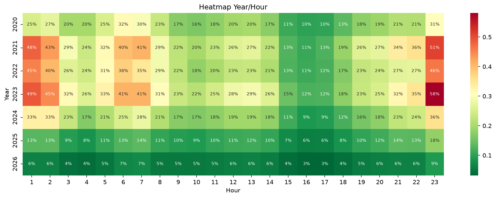

# Quant XAUUSD · Searching for a real edge in gold (M5)

*A quantitative research project: can a systematic strategy beat costs on XAUUSD 5-minute data — and can we **prove** it isn't luck?*

Most retail trading projects show a nice equity curve. This one does the opposite: every idea is tested against **random-entry controls**, **direction placebos** and an **untouched out-of-sample period**, with **realistic costs**. The goal is not to find a pretty backtest, but to find out what is statistically real.

> **Main finding:** with realistic costs, gold M5 (2020–2026) shows **no stable, demonstrable directional edge** with the methods tested. One reversion effect was real in-sample (p ≈ 0.02) and vanished out-of-sample (p = 0.91). An ML model learned *when* to trade, but not *which direction*.

---

## Data & cost model

| | |
|---|---|
| **Instrument** | XAUUSD, M5 candles, MetaTrader 5 export |
| **Period** | Jan 2020 – 2026 (~480,000 candles) |
| **In-sample / Out-of-sample** | 2020–2024 / 2025–2026 (OOS never used for tuning) |
| **Cost per trade** | Spread floor 20 points + 5 points slippage = **$0.25**, no commission |
| **Unit of result** | **R** (profit ÷ stop distance), not dollars — gold's volatility grew ~5× since 2023, so $ results are misleading |

Data quality checks: 0 impossible candles, 0 duplicates. The broker's spread field was 0 in 56–58 % of candles in 2021–22, which is why a **spread floor** is imposed instead of trusting the raw field.

## Methodology

1. **Market physics first** — understand the price process before designing any strategy.
2. **Random-entry control** — what does a random strategy earn with the same SL/TP and costs? (≈ −0.13 R). Any strategy must beat this, not zero.
3. **Direction placebo** — same entry candles, random direction (200 simulations). If a strategy can't beat its own placebo, its "edge" is just *when* it trades, not *what* it predicts.
4. **Conservative simulation** — if SL and TP are hit in the same candle, the SL counts. Entry at the next candle's open. One position at a time.
5. **Walk-forward ML** — models retrained every year, trained only on past data with a 2-day purge gap.

## Results

### 1 · Market physics (`02_market.ipynb`)

| Measure | Result | Meaning |
|---|---|---|
| Kurtosis of returns | **48.4** (normal = 3) | Extremely fat tails: 0.74 % of candles move > 4σ |
| Autocorrelation of returns (lag 1) | −0.01 overall, ≈ 0 since 2023 | Direction has no short-term memory |
| Autocorrelation of \|returns\| | 0.35 | Volatility clusters strongly |
| Hurst exponent by year | 0.48 – 0.51 | Indistinguishable from a random walk |
| Variance ratio by hour | 0.83 at 22h, 0.85 at 11h, 1.10 at 16h | Mild mean reversion at 11h/22h, momentum at 16h (NY open) |
| Half-life vs shuffled placebo | ratio 0.97 | Mean reversion barely stronger than pure noise |



*Cost as a % of the median candle range: trading costs weighed much more in 2020–2022 than today.*

### 2 · Hypotheses tested (`03_strategy.ipynb`, `04_parameters.ipynb`)

| Hypothesis | Trades | expR | vs placebo | Verdict |
|---|---|---|---|---|
| **Random control** | 8,416 | −0.132 | — | Baseline to beat |
| **A · Mean reversion to EMA at 11h/22h** | 2,950 | −0.109 | p = 0.03 | Beats placebo, but not costs |
| **A · tuned in-sample** (k = 2.5, SL 2, TP 1.5) | 1,342 | −0.066 | +0.069 R, p < 0.01 | Real effect **in-sample**… |
| **A · out-of-sample 2025–26** | 482 | −0.082 | −0.040 R, **p = 0.91** | …that **disappears** OOS |
| **B · NY pre-market range breakout** | 1,588 | −0.078 | p = 0.70 | No directional edge |
| **B · + compression filter / let it run** | 482–1,587 | −0.004 to −0.028 | p = 0.40–0.89 | No directional edge |
| **C · Straddle after compression** | 482 | +0.08 IS / +0.41 OOS | t = 0.50 / 1.41 | A hint, not statistically significant |

Strategy A year by year (advantage over placebo): positive every year 2020–2024 (+0.01 to +0.12 R), negative in 2025 and 2026 (−0.04, −0.05 R). The effect existed — and the market regime changed.

### 3 · Machine learning (`06_ML.ipynb`)

LightGBM, walk-forward 2022–2026, 13 causal features (z-score to EMA, daily trend, volatility regime, recent returns, relative cost, cyclic hour).

| Model | OOS result | Verdict |
|---|---|---|
| **Classifier filtering strategy A signals** | +0.006 to +0.023 R over random selection, p = 0.20–0.38 | No significant improvement |
| **Regressor predicting expected R** | 2022 strong (+0.15 R, p < 0.01), then ≈ 0 | Only works in one regime |
| **Free-direction model** (scores every candle, buy vs sell, trailing exit) | +0.014 R overall, t = 0.23 | Learns **when** to trade, not **where** |

The diagnostic that explains it: from 2023 on, the free-direction model buys 67–88 % of the time. On the same candles, **"always buy" would have done better in 2026** (+0.184 R vs +0.142 R). The model learned gold's bullish bias and to trade when volatility makes costs small — not to predict direction. The most important feature was always `coste_rel` (cost relative to volatility).

## Conclusions

1. **Costs decide everything on M5.** Most of the 2025–26 "improvement" of every strategy comes from gold's volatility rising and making the fixed cost relatively smaller — the random control improves too.
2. **A real effect is not a tradable edge.** Strategy A was statistically real in-sample and still lost money after costs, then disappeared out-of-sample.
3. **Placebos catch what equity curves hide.** Several variants looked good OOS, but their own direction placebos did just as well.
4. **ML amplifies what is in the data.** With no directional signal in the features, the model found bias and volatility timing instead.

## Project structure

```
Quant/
├── src/
│   ├── config.py        # paths, symbol, cost model
│   ├── data.py          # MT5 CSV loader
│   ├── indicators.py    # ATR
│   ├── backtest.py      # trade simulation (SL/TP and trailing), backtest, direction placebo
│   ├── strategies.py    # signal generators (A: reversion, B: NY breakout)
│   ├── features.py      # causal features and ML datasets
│   └── stats.py         # Hurst, half-life (OU), ACF
├── notebooks/
│   ├── 01_datos.ipynb       # data loading and quality checks
│   ├── 02_market.ipynb      # market physics
│   ├── 03_strategy.ipynb    # random control, hypotheses A and B, placebos
│   ├── 04_parameters.ipynb  # in-sample grid and out-of-sample test of A
│   └── 06_ML.ipynb          # LightGBM walk-forward
└── reports/                 # saved results and figures
```

## How to reproduce

```bash
git clone https://github.com/K4iserDev/Quant.git
cd Quant
python -m venv .venv
.venv\Scripts\activate          # Windows  (source .venv/bin/activate on Linux/macOS)
pip install -r requirements.txt
```

Data is not included. Export XAUUSD M5 history from MetaTrader 5 (*View → Symbols → Bars → Export*) and save it as `data/raw/XAUUSD_M5.csv`, then run the notebooks in order.

## Next steps

- Neural network on the same dataset to compare against LightGBM.
- Ablation table: fixed rules vs ML for entries and risk management.
- Apply the same pipeline to other assets (NAS100, BTCUSD) and higher timeframes (M15, H1), where costs weigh less.

---

**Stack:** Python · pandas · NumPy · SciPy · statsmodels · LightGBM · Matplotlib · Seaborn · Jupyter

*Research project, not financial advice.*
