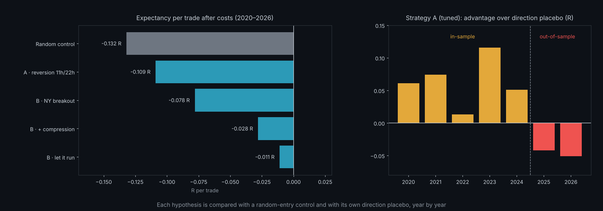
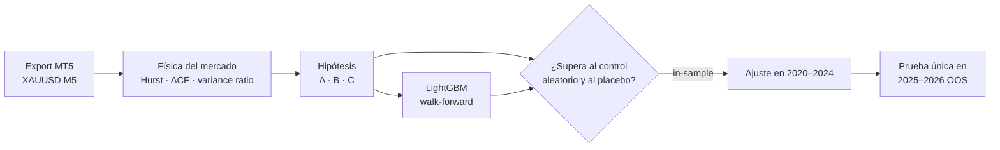
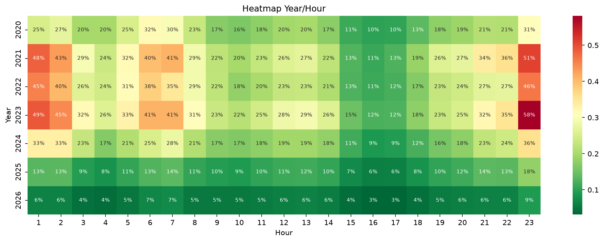

# 📈 Quant XAUUSD · Buscando una ventaja real en el oro (M5)

*[Read in English](README.md)*


*Proyecto de investigación cuantitativa: ¿puede una estrategia sistemática superar los costes en datos de XAUUSD a 5 minutos, y podemos **demostrar** que no es suerte?*

La mayoría de proyectos de trading minorista enseñan una curva de capital bonita. Este hace lo contrario: cada idea se contrasta con **controles de entrada aleatoria**, **placebos de dirección** y un **periodo fuera de muestra sin tocar**, con **costes realistas**. El objetivo no es encontrar un backtest bonito, sino averiguar qué es estadísticamente real.



---

## 📊 Datos y modelo de costes

| | |
|---|---|
| **Instrumento** | XAUUSD, velas M5 |
| **Periodo** | Enero 2020 – 2026 |
| **In-sample / Out-of-sample** | 2020–2024 / 2025–2026 (el OOS nunca se usa para ajustar) |
| **Coste por operación** | Spread mínimo de 20 puntos + 5 puntos de slippage = **0,25 $**, sin comisión |
| **Unidad de resultado** | **R** (beneficio ÷ distancia al stop), no dólares: la volatilidad del oro se ha multiplicado por ~5 desde 2023, así que los resultados en $ engañan |

## 🔬 Metodología

1. **Primero, la física del mercado**: entender el proceso del precio antes de diseñar ninguna estrategia.
2. **Control de entrada aleatoria (referencia)**: ¿cuánto gana una estrategia al azar con el mismo SL/TP y los mismos costes? (≈ −0,13 R). Cualquier estrategia tiene que superar esto, no el cero.
3. **Placebo de dirección**: las mismas velas de entrada con la dirección al azar (200 simulaciones). Si una estrategia no supera a su propio placebo, su "ventaja" está solo en *cuándo* opera, no en *qué* predice.
4. **Simulación conservadora**: si en una misma vela se tocan el SL y el TP, cuenta el SL. Entrada en la apertura de la vela siguiente. Una posición a la vez.
5. **ML walk-forward**: modelos reentrenados cada año, solo con datos pasados y con 2 días de separación (purga).



## 📈 Resultados

### 1 · Física del mercado (`02_market.ipynb`)

| Medida | Resultado | Qué significa |
|---|---|---|
| Curtosis de los retornos | **48,4** (normal = 3) | Colas muy gordas: el 0,74 % de las velas se mueve más de 4σ |
| Autocorrelación de los retornos (lag 1) | −0,01 en total, ≈ 0 desde 2023 | La dirección no tiene memoria a corto plazo |
| Autocorrelación de \|retornos\| | 0,35 | La volatilidad se agrupa con fuerza |
| Exponente de Hurst por año | 0,48 – 0,51 | Indistinguible de un paseo aleatorio |
| Variance ratio por hora | 0,83 a las 22h, 0,85 a las 11h, 1,10 a las 16h | Ligera reversión a las 11h/22h, momentum a las 16h (apertura de NY) |
| Half-life frente a placebo barajado | ratio 0,97 | La reversión a la media apenas es más fuerte que el ruido puro |



*Coste como % del rango mediano de la vela: los costes pesaban mucho más en 2020–2022 que hoy.*

### 2 · Hipótesis probadas (`03_strategy.ipynb`, `04_parameters.ipynb`)

| Hipótesis | Operaciones | expR | frente a placebo | Veredicto |
|---|---|---|---|---|
| **Control aleatorio** | 8.416 | −0,132 | — | Referencia a superar |
| **A · Reversión a la EMA a las 11h/22h** | 2.950 | −0,109 | p = 0,03 | Supera al placebo, pero no a los costes |
| **A · ajustada in-sample** (k = 2,5, SL 2, TP 1,5) | 1.342 | −0,066 | +0,069 R, p < 0,01 | Efecto real **in-sample**… |
| **A · out-of-sample 2025–26** | 482 | −0,082 | −0,040 R, **p = 0,91** | …que **desaparece** fuera de muestra |
| **B · Ruptura del rango previo a NY** | 1.588 | −0,078 | p = 0,70 | Sin ventaja direccional |
| **B · + filtro de compresión / dejar correr** | 482–1.587 | −0,004 a −0,028 | p = 0,40–0,89 | Sin ventaja direccional |
| **C · Straddle tras compresión** | 482 | +0,08 IS / +0,41 OOS | t = 0,50 / 1,41 | Una pista, no estadísticamente significativa |

Estrategia A año a año (ventaja sobre el placebo): positiva todos los años de 2020 a 2024 (+0,01 a +0,12 R) y negativa en 2025 y 2026 (−0,04 y −0,05 R). El efecto existía, y el régimen del mercado cambió.

### 3 · Machine learning (`06_ML.ipynb`)

LightGBM, walk-forward 2022–2026, 13 features causales (z-score respecto a la EMA, tendencia diaria, régimen de volatilidad, retornos recientes, coste relativo, hora cíclica).

| Modelo | Resultado OOS | Veredicto |
|---|---|---|
| **Clasificador que filtra las señales de A** | +0,006 a +0,023 R sobre selección aleatoria, p = 0,20–0,38 | Sin mejora significativa |
| **Regresor que predice la R esperada** | 2022 fuerte (+0,15 R, p < 0,01), después ≈ 0 | Solo funciona en un régimen |
| **Modelo de dirección libre** (puntúa cada vela, compra o venta, salida con trailing) | +0,014 R en total, t = 0,23 | Aprende **cuándo** operar, no **hacia dónde** |

El diagnóstico que lo explica: desde 2023, el modelo de dirección libre compra entre el 67 y el 88 % de las veces. En esas mismas velas, **"comprar siempre" habría dado más en 2026** (+0,184 R frente a +0,142 R). El modelo aprendió el sesgo alcista del oro y a operar cuando la volatilidad hace que el coste pese poco, no a predecir la dirección. La feature más importante fue siempre `coste_rel` (coste relativo a la volatilidad).

## 🧠 Conclusiones

1. **En M5, los costes lo deciden todo.** La mayor parte de la "mejora" de 2025–26 de todas las estrategias viene de que la volatilidad del oro subió y el coste fijo pesa relativamente menos: el control aleatorio también mejora.
2. **Un efecto real no es una ventaja operable.** La estrategia A era estadísticamente real in-sample, aun así perdía dinero después de costes, y luego desapareció fuera de muestra.
3. **Los placebos detectan lo que las curvas de capital esconden.** Varias variantes parecían buenas fuera de muestra, pero sus propios placebos de dirección lo hacían igual de bien.
4. **El ML amplifica lo que hay en los datos.** Sin señal direccional en las features, el modelo encontró sesgo y timing de volatilidad.

## 🗂️ Estructura del proyecto

```
Quant/
├── src/
│   ├── config.py        # rutas, símbolo, modelo de costes
│   ├── data.py          # carga del CSV de MT5
│   ├── indicators.py    # ATR
│   ├── backtest.py      # simulación de operaciones (SL/TP y trailing), backtest, placebo de dirección
│   ├── strategies.py    # generadores de señales (A: reversión, B: ruptura NY)
│   ├── features.py      # features causales y datasets de ML
│   └── stats.py         # Hurst, half-life (OU), ACF
├── notebooks/
│   ├── 01_datos.ipynb       # carga de datos y controles de calidad
│   ├── 02_market.ipynb      # física del mercado
│   ├── 03_strategy.ipynb    # control aleatorio, hipótesis A y B, placebos
│   ├── 04_parameters.ipynb  # rejilla in-sample y prueba out-of-sample de A
│   └── 06_ML.ipynb          # LightGBM walk-forward
├── reports/                 # resultados y figuras guardados
└── docs/                    # imágenes de este README
```

## 🚀 Cómo reproducirlo

```bash
git clone https://github.com/K4iserDev/Quant.git
cd Quant
python -m venv .venv
.venv\Scripts\activate          # Windows  (source .venv/bin/activate en Linux/macOS)
pip install -r requirements.txt
```

Los datos no se incluyen. Exporta el histórico de XAUUSD M5 desde MetaTrader 5 (*Ver → Símbolos → Barras → Exportar*), guárdalo como `data/raw/XAUUSD_M5.csv` y ejecuta los notebooks en orden.

## 🛣️ Próximos pasos

- [ ] Red neuronal sobre el mismo dataset para compararla con LightGBM.
- [ ] Tabla de ablación: reglas fijas frente a ML para entradas y gestión del riesgo.
- [ ] Aplicar el mismo pipeline a otros activos (NAS100, BTCUSD) y a timeframes mayores (M15, H1), donde los costes pesan menos.

---

**Stack:** Python · pandas · NumPy · SciPy · statsmodels · LightGBM · Matplotlib · Seaborn · Jupyter

*Proyecto de investigación, no es asesoramiento financiero.*

**Autor:** Asier Martin · [GitHub](https://github.com/K4iserDev) · [LinkedIn](https://www.linkedin.com/in/asier-martin01)
